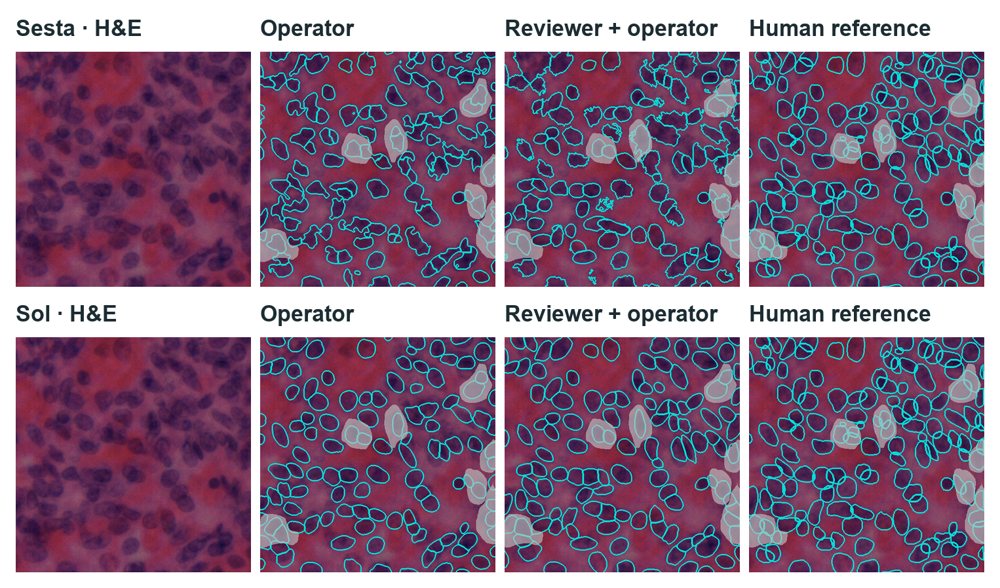

# Sol’s Hammer

Sol’s Hammer is a standalone workbench for reviewing H&E images in Codex. GPT-6.2 Sol can inspect several fields in one session, choose segmentation tools, draw on a mask and type individual nuclei. Each field keeps its own contours and edit history.

## Why Sol Ultrafast?

Image review takes repeated exchanges. The model requests a crop, sees how a candidate fits the tissue, edits the mask and looks again. ChatGPT Pro 20× ($200/month) includes GPT-6.2 Sol Ultrafast in Codex. This workbench pairs that lower-latency tier with **xhigh** reasoning and lets the operator batch independent decisions across fields. The timings below measure the whole review, including image inspection and tool calls. [Codex plan and speed settings](https://help.openai.com/en/articles/20001275-chatgpt-work-and-codex) · [ChatGPT Pro tiers](https://help.openai.com/en/articles/9793128-about-chatgpt-pro-tiers)



In the lower row, Sol’s reviewer and operator together found **73 of 159** reference nuclei, up from **55** for the operator alone. They recovered 26 previous misses, lost 8 previous matches and reduced false positives from 52 to 41. [Field notes and image credits](docs/gallery/README.md#recovering-nuclei-in-a-crowded-field)

## Run a review

Use Python 3.10 or later and a signed-in Codex CLI with access to Sol Ultrafast. From this repository, prepare an H&E field and choose a mode.

```sh
python -m pip install ./packages/pathology-tools .
sols-hammer prepare --image field.png --field runs/fields/F01
sols-hammer workbench --mode hybrid --fields runs/fields/F01 --output runs/review
```

Pass more field directories after `--fields` to review them together. Use a fresh output directory for each run.

| Mode | Starting point and controls |
|---|---|
| **Tool-guided** | Compare tool contours and select or combine them locally. |
| **Model-guided** | Start from a blank mask and draw or write an image-processing step. |
| **Hybrid** | A second Sol session inspects the raw image and candidates, then chooses a starting route per field. The operator can use tools, draw or do both. |

Before saving a hybrid result, the operator compares the source, start and latest edit, chooses the contours to keep, and assigns cell types. The output includes instance masks, per-field decisions, an edit history and a usage receipt.

## Results

The archived comparison used the same 40 images as Sesta Workbench. Scores are image means against human annotations from the workflow preceding the release’s final side-by-side contour check.

| Sol on 40 images | Operator | Reviewer + operator |
|---|---:|---:|
| Instance F1 · 20 typed nuclear fields | .767 | .793 |
| Typed instance F1 · same 20 | .334 | .415 |
| Instance F1 · 10 multi-tissue fields | .605 | .648 |
| Foreground Dice · 10 lung fields | .621 | .707 |
| Summed batch time | 30.11 min | 31.53 min |
| Total tokens, including cached input | 23.44M | 27.72M |

[Image gallery, fixed baselines and both workbenches’ results](docs/gallery/README.md) · [Download field-level scores](docs/gallery/fields.csv) · [Sesta Workbench for Astra](https://github.com/chaosbeagle/sixth-magnitude)

## Where the name comes from

In Marvel Comics’ *New Avengers* (2013) #4, “World Eater,” Tony Stark shows the Illuminati a solar collector under construction near the Sun. This partial Dyson sphere is Sol’s Hammer. Jonathan Hickman wrote the issue and Steve Epting drew it. The workbench borrows the name for its connection to Sol. [Marvel’s companion feature on the Dyson sphere](https://www.youtube.com/watch?v=SHAogS8oHS4) · [Issue credits](https://www.comics.org/issue/1095443/) · [Sol’s Hammer and its appearances](https://marvel.fandom.com/wiki/Sol%27s_Hammer)

[Code license](LICENSE.md) · [Image credits and terms](docs/gallery/README.md#image-credits-and-terms)
